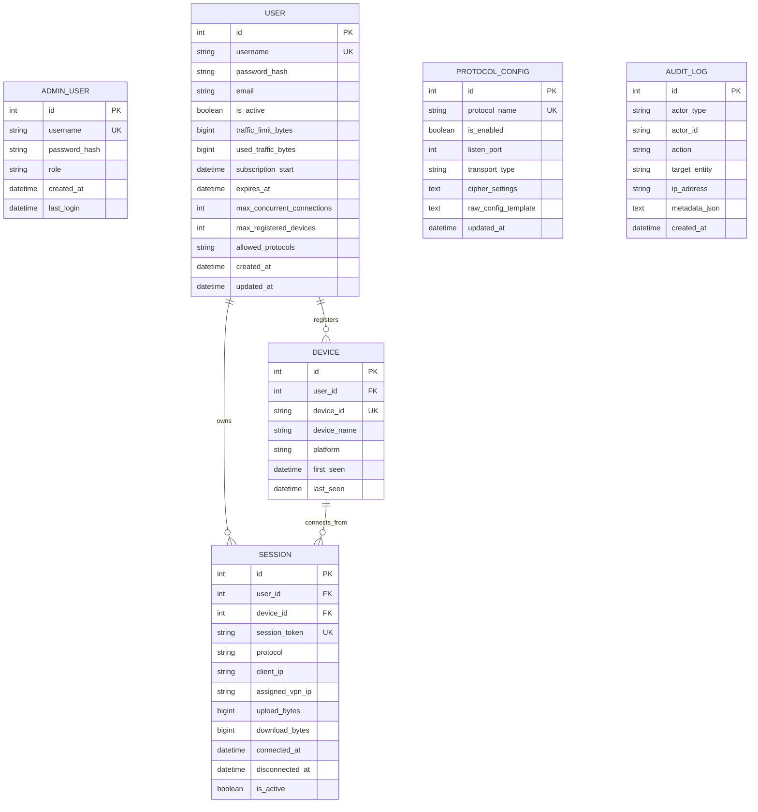

# RouterLink System Architecture Specification

## 1. Executive Summary & Vision

**RouterLink** is a production-grade, modular VPN service management and client delivery ecosystem designed to run natively inside **MikroTik RouterOS 7 Containers** while providing an intuitive **Web Administration Panel** and a native **Android Client Application**.

The primary objective is to transform any standard MikroTik RouterOS 7 device (CHR x86_64 or ARM64 hardware) into a self-contained, enterprise-grade VPN service gateway without compromising router security, performance, or existing networking setups.

---

## 2. High-Level Architectural Model

```mermaid
flowchart TB
    subgraph Client_Tier [Client Tier]
        AndroidApp["📱 RouterLink Android Client<br/>(Kotlin + Jetpack + VpnService)"]
        AdminBrowser["💻 Admin Web Browser<br/>(React + TypeScript + Tailwind)"]
    end

    subgraph RouterOS_Host [MikroTik RouterOS 7 Host Device]
        direction TB
        ROS_Firewall["RouterOS Firewall / NAT<br/>(Port Forwards & IP Isolation)"]
        ROS_VETH["Virtual Ethernet Interface<br/>(veth-routerlink: 172.28.0.1/24)"]
        ROS_Storage["Persistent Storage Mount<br/>(/routerlink/data on disk/USB)"]
        
        subgraph RouterLink_Container [RouterLink Linux Container (172.28.0.2)]
            direction TB
            subgraph Web_API_Layer [API & Presentation]
                FastAPI["FastAPI REST & WebSocket Server<br/>(Python 3.11/3.12 + Uvicorn)"]
                WebUI_Static["Embedded WebUI SPA Assets<br/>(React Production Build)"]
            end

            subgraph Core_Engine [Core Engine & Business Logic]
                AuthMgr["Auth & RBAC Manager<br/>(JWT + bcrypt/argon2)"]
                UserMgr["User & Quota Manager<br/>(Traffic & Expiration Control)"]
                SessionMgr["Session Tracking Engine<br/>(Concurrent Session Enforcer)"]
                ProtocolDaemon["Protocol Abstraction Engine<br/>(Lifecycle & Config Generator)"]
                AccountingWorker["Real-time Accounting Daemon<br/>(Periodic Traffic Collector)"]
            end

            subgraph Storage_Layer [Storage & Persistence]
                SQLiteDB[("SQLite 3 DB (WAL Mode)<br/>+ Alembic Migrations")]
                CertStorage["TLS Certificates & Keys<br/>(PKI Store)"]
            end

            subgraph VPN_Subsystem [VPN Protocol Daemons]
                OpenVPN["OpenVPN Server<br/>(tun0 - TCP:8443 / UDP:1194)"]
                WireGuard["WireGuard Engine<br/>(wg0 - UDP:51820)"]
                ExtProtocols["Modular Protocol Plugins<br/>(IKEv2 / Xray / etc.)"]
            end
        end
    end

    subgraph Internet_WAN [WAN & External Traffic]
        WAN["Public Internet / ISP"]
    end

    AdminBrowser -->|HTTPS / Port 8443 or 8080| ROS_Firewall
    AndroidApp -->|REST API Config Sync / Port 8443| ROS_Firewall
    AndroidApp -->|Tunneled VPN Traffic (TCP/UDP)| ROS_Firewall

    ROS_Firewall --> ROS_VETH
    ROS_VETH --> Web_API_Layer
    ROS_VETH --> VPN_Subsystem

    Web_API_Layer --> Core_Engine
    Core_Engine --> Storage_Layer
    Core_Engine --> VPN_Subsystem

    VPN_Subsystem -->|Encrypted Forwarding| ROS_Firewall --> WAN
    Storage_Layer -.->|Volume Mount| ROS_Storage
```

---

## 3. Component Deep Dive

### 3.1 MikroTik RouterOS 7 Container Host Integration

MikroTik RouterOS 7 features a native Linux Container runtime (`/container`). RouterLink optimizes execution within RouterOS constraints:

1. **Network Topology & VETH**:
   - A dedicated Virtual Ethernet (`veth-routerlink`) is attached to a dedicated bridge (`bridge-routerlink`) or existing LAN bridge with a private static subnet:
     - Gateway (RouterOS VETH): `172.28.0.1/24`
     - Container IP: `172.28.0.2/24`
   - **Port Isolation & Port Forwarding**:
     - Web Administration & REST API: TCP `8080` (or configured custom port).
     - OpenVPN Tunnel: TCP `8443` (primary anti-censorship / corporate firewall bypass) and/or UDP `1194`.
     - WireGuard Tunnel: UDP `51820`.
   - Dedicated NAT `dstnat` and `srcnat` rules ensure that external clients can reach the services, while all container traffic outbound to the Internet is masqueraded.

2. **Persistent Storage Isolation**:
   - Containers in RouterOS have ephemeral root overlays. If the container stops or is re-pulled, non-mounted data is destroyed.
   - RouterLink strictly mounts a host path (e.g. `/routerlink/data` or `usb1/routerlink/data`) into `/data` inside the container:
     - `/data/db/routerlink.db`: SQLite database and WAL logs.
     - `/data/certs/`: PKI CA, server certificates, and client keys.
     - `/data/config/`: Runtime configuration overrides.
     - `/data/logs/`: Structured JSON log files.

3. **Resource Efficiency**:
   - Designed for low-spec CHR/hEX/RB-series devices:
     - Target Base Memory Footprint: `< 95 MB` RSS.
     - Ultra-lightweight container base (Alpine Linux 3.20 or Debian 12 Slim).
     - Multi-architecture container images: `linux/amd64` (x86_64) and `linux/arm64` (ARM64 v8).

---

### 3.2 RouterLink Server Backend

The backend is built in **Python 3.11+ / FastAPI** using an asynchronous, modular architecture.

#### Architectural Layers:
- **Presentation Layer (API)**:
  - `/api/v1/admin/*`: Protected management endpoints (Users, Protocols, System, Sessions, Metrics).
  - `/api/v1/client/*`: Protected client endpoints for Android (Authentication, Subscription info, Fetch VPN config profiles, Heartbeat).
  - `/api/v1/auth/*`: Token issuance, refreshment, and MFA.
- **Service & Domain Layer**:
  - `UserService`: User lifecycle, credentials, quotas, subscription scheduling.
  - `ProtocolService`: Protocol state machine, server start/stop/reload, port binding check.
  - `AccountingService`: Parsing byte counters from kernel/sockets, quota enforcement, auto-kill on quota exhaustion.
  - `CertService`: Automated Easy-RSA/cryptography PKI management for OpenVPN and WireGuard key pairs.
- **Data Access Layer**:
  - SQLAlchemy 2.0 with asynchronous and synchronous sessions.
  - SQLite with WAL (Write-Ahead Logging), `PRAGMA synchronous = NORMAL`, and `PRAGMA foreign_keys = ON`.
  - Alembic for deterministic schema versioning and forward/backward migrations.

---

### 3.3 Protocol Abstraction Layer (PAL)

To maintain true modularity, all VPN protocol engines implement a common interface:

```python
class ProtocolEngine(ABC):
    @abstractmethod
    async def initialize(self) -> None: ...
    
    @abstractmethod
    async def start(self) -> bool: ...
    
    @abstractmethod
    async def stop(self) -> bool: ...
    
    @abstractmethod
    async def restart(self) -> bool: ...
    
    @abstractmethod
    async def get_status(self) -> ProtocolStatus: ...
    
    @abstractmethod
    async def generate_client_config(self, user: User, device: Device) -> str: ...
    
    @abstractmethod
    async def disconnect_session(self, session_id: str) -> bool: ...
    
    @abstractmethod
    async def collect_traffic_metrics(self) -> List[SessionMetric]: ...
```

#### Protocol Modules:
1. **OpenVPN Engine**:
   - Runs in tun mode. Supports TCP 8443 and UDP 1194.
   - Dynamic client authentication through management interface socket or custom auth script.
   - Dynamic client disconnect via management socket command (`kill <common_name>`).
   - Byte-level session accounting through `status` logs or management socket queries.
2. **WireGuard Engine**:
   - Runs via Linux kernel WireGuard or userspace `wireguard-go`.
   - Key generation per user/device.
   - Real-time accounting through `wg show <interface> dump` parsing.
   - Dynamic peer removal to terminate exhausted sessions.
3. **Future Extension Slots**:
   - IKEv2 / IPsec (StrongSwan), VLESS / Shadowsocks.

---

### 3.4 Web Administration Panel (WebUI)

- **Tech Stack**: React 18/19, TypeScript, Vite, Tailwind CSS, Lucide Icons, Recharts.
- **Features**:
  - **Live Dashboard**: Hardware resource gauges (CPU, RAM, Disk), active users, active connections, real-time throughput chart.
  - **User Management**: Add/Edit/Delete, Traffic quotas (GB), Subscription expiration (Date/Unlimited), Max simultaneous devices, Protocol checkboxes, Instant credentials generator & QR code viewer.
  - **Protocol Hub**: Enable/Disable, change ports, view raw and structured daemon logs, restart daemon with 1-click, certificate generator.
  - **Session Manager**: Real-time table of connected users, client IP, device ID, connection duration, upload/download stats, with a 1-click "Kill Session" button.
  - **System Settings & Maintenance**: Backup configuration to encrypted zip, restore backup, view audit logs, factory reset, container restart.
  - **Theme**: Dark and Light mode with persistent state. Fully responsive for mobile and desktop screens.

---

### 3.5 Android Client Application

- **Tech Stack**: Kotlin, Jetpack Compose, Material 3, Android Architecture Components (Clean Architecture + MVI/MVVM), Coroutines & Kotlin Flow, AndroidX `VpnService`.
- **Core Modules**:
  - `core:network`: Retrofit / OkHttp3 client communicating with RouterLink REST API over TLS.
  - `core:database`: Room database for local caching of connection profiles, credentials, and offline history.
  - `core:vpn`: Unified VPN engine interfacing with Android `VpnService`.
    - OpenVPN Native Core (JNI wrapper around official OpenVPN 3 / ICS OpenVPN tunnel).
    - WireGuard Native Core (`com.wireguard.android:tunnel`).
  - `feature:auth`: Server address input, QR code scanner for quick login, credentials authentication.
  - `feature:dashboard`: Large interactive Connect/Disconnect toggle, live upload/download speedometers, quota card, expiration countdown, protocol picker.
  - `feature:diagnostics`: Real-time ping test, DNS leak test, connection log viewer, MTU and socket error reports.
- **Reliability Features**:
  - Auto-reconnect on network switch (WiFi <-> LTE).
  - Always-on VPN and Kill-switch support.
  - Battery optimization whitelist prompt.
  - Zero fake state: tunnel status strictly reflects OS `VpnService` socket state.

---

## 4. Database Schema Design (SQLite)



---

## 5. Security & Threat Modeling

1. **Host-Container Isolation**:
   - The container runs inside a dedicated VETH bridge. Container rootfs is read-only except for mounted `/data`.
   - Capabilities are restricted strictly to `NET_ADMIN` (required for TUN/TAP devices) and `NET_RAW`.
2. **Zero Plaintext Secrets**:
   - Admin and user passwords hashed using `argon2id` / `bcrypt` with work factor 12+.
   - JWT tokens signed with cryptographically random 256-bit keys generated during initial setup.
   - No hardcoded passwords, API tokens, or private keys in Git repository.
3. **Traffic Quota & Expiration Enforcement**:
   - Background daemon runs every 10 seconds.
   - If `used_traffic_bytes >= traffic_limit_bytes` or `now() >= expires_at`, the engine immediately terminates active TUN/WG sessions and revokes token permissions.
4. **Rate Limiting & Anti-Brute-Force**:
   - FastAPI middleware throttles failed login attempts (e.g. 5 attempts / minute per IP).

---

## 6. MikroTik Automated Lifecycle Management

The `install.rsc` script is completely automated, idempotent, and non-destructive:
- **System Verification**: Checks RouterOS version (`>= 7.10`), verifies `/container` package exists, tests free disk space (`>= 150 MB`), checks free RAM (`>= 64 MB`).
- **Resource Reservation**: Creates `/interface/veth/add name=veth-routerlink address=172.28.0.2/24 gateway=172.28.0.1`.
- **Bridge Configuration**: Creates `bridge-routerlink` and assigns `172.28.0.1/24`.
- **Firewall & NAT**: Inserts named rules with specific comments, avoiding touching existing rules.
- **Image Deployment**: Pulls container image from GitHub Container Registry (GHCR) and launches it with mount point `/routerlink/data`.
- **Idempotency & Clean Rollback**: Running `install.rsc` multiple times is safe; running `uninstall.rsc` cleanly removes only RouterLink-owned resources.

