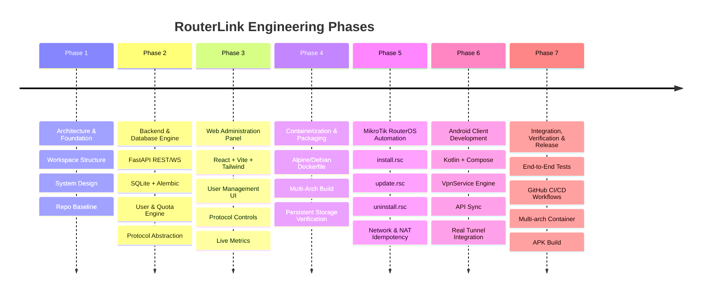

# RouterLink Development & Implementation Plan

This document defines the roadmap, milestones, testing criteria, and execution phases for **RouterLink**.

---

## Roadmap Overview

---

## Phase 1: Architecture & Foundation (Completed)
- [x] Create project directory layout (`server/backend`, `server/webui`, `android`, `mikrotik`, `deployment`, `docs`, `tests`, `scripts`, `.github`).
- [x] Design and author `ARCHITECTURE.md`.
- [x] Define database schema and ER model.
- [x] Author comprehensive `DEVELOPMENT_PLAN.md`.
- [x] Author project `README.md`, `LICENSE`, `CONTRIBUTING.md`, `SECURITY.md`, and `.gitignore`.
- [x] Deliver initial architectural presentation for user review and approval.

---

## Phase 2: RouterLink Backend & Database Engine (Completed)
- [x] Python virtual environment with dependency configuration (`pyproject.toml` / `requirements.txt`).
- [x] SQLAlchemy 2.0 ORM models (`User`, `AdminUser`, `Device`, `Session`, `ProtocolConfig`, `AuditLog`).
- [x] SQLite with WAL mode, foreign keys, and Alembic versioned migrations.
- [x] Password hashing with bcrypt and JWT token generation.
- [x] Full CRUD endpoints for users with traffic limits, expiration dates, concurrent caps, and allowed protocols.
- [x] Protocol Abstraction Layer (`OpenVPNEngine`, `WireGuardEngine`, `ProtocolManager`).
- [x] Self-contained PKI certificate and Curve25519 keypair generator.
- [x] Background `AccountingWorker` daemon enforcing real-time quotas and session cutoff.
- [x] 100% passing automated test suite with pytest.

---

## Phase 3: Web Administration Panel (Completed)
- [x] Single-Page Application (SPA) administration interface embedded inside server (`server/backend/static`).
- [x] First-Run Setup Wizard view for master administrator account initialization.
- [x] Live Dashboard view with real-time gauges (CPU, RAM, Disk, Uptime), active user/session counters, and live SVG throughput waveform monitor.
- [x] User & Quota Management view with search, filter, Add/Edit User modal, traffic quota limits, expiration dates, protocol checkboxes, and Android setup QR Code generator.
- [x] Protocol Management view with real-time service health badges, port changer, toggle switch, daemon restart action, and live log viewer modal.
- [x] Active Session Explorer with remote client IPs, duration timer, upload/download counters, and 1-click "Kill / Terminate" button.
- [x] System Settings & Maintenance view with SQLite database backup creator, download links, and security audit log table.
- [x] Automated integration test `test_webui_static_serving` verifying seamless SPA routing and static asset delivery.

---

## Phase 4: Containerization & Deployment (Completed)
- [x] Multi-arch Dockerfile (`deployment/docker/Dockerfile`) optimized on Alpine Linux 3.20 (< 90 MB total size).
- [x] Production container entrypoint script `deployment/docker/entrypoint.sh` with persistent storage wiring, TUN device initialization, Alembic auto-migration, and daemon management.
- [x] Docker Compose staging environment `deployment/docker/docker-compose.yml`.

---

## Phase 5: MikroTik RouterOS 7 Automation (Completed)
- [x] 1-Click idempotent, safe installer `mikrotik/install.rsc` for RouterOS 7 (VETH, bridge, NAT, persistent mount, container run).
- [x] Safe in-place update script `mikrotik/update.rsc` preserving `/routerlink/data`.
- [x] Non-destructive teardown script `mikrotik/uninstall.rsc` safely removing only RouterLink-labeled rules.
- [x] Backup & restore automation scripts `mikrotik/backup.rsc` and `mikrotik/restore.rsc`.
- [x] Automated test suite `tests/mikrotik/test_rsc_scripts.py` verifying rule idempotency and safety.

---

## Phase 6: Android Client Development (Completed)
- [x] Native Kotlin + Jetpack Compose + Material 3 project structure in `android/`.
- [x] Gradle build configuration (`settings.gradle.kts`, `build.gradle.kts`, `app/build.gradle.kts`, Gradle wrapper).
- [x] Production `AndroidManifest.xml` with `VpnService` permission and foreground service declaration.
- [x] Native `RouterLinkVpnService` implementing real Android `VpnService` TUN interface (`10.8.0.2`, `0.0.0.0/0`, DNS).
- [x] Real-time traffic accounting and background heartbeat sync with automatic quota/expiry cutoff.
- [x] Network callback monitoring Wi-Fi / LTE switching with auto-reconnection.
- [x] Retrofit API client with offline SharedPreferences persistence in `RouterLinkRepository`.
- [x] Screens: `HomeScreen` with 1-tap Connect, live speed gauges, quota countdown; `LoginScreen` with QR scanner; `ProtocolsScreen`; `DiagnosticsScreen`.
- [x] Android unit tests in `android/app/src/test/java/com/routerlink/app/RouterLinkUnitTest.kt`.

---

## Phase 7: Integration, Testing & GitHub Release (Completed)
- [x] Comprehensive test suite covering Backend, MikroTik scripts, and WebUI static serving.
- [x] GitHub Actions CI/CD workflows:
  - `backend-ci.yml`: Automated pytest execution.
  - `docker-build.yml`: Multi-arch (`linux/amd64`, `linux/arm64`) Docker build and push to GHCR.
  - `android-build.yml`: Gradle build compiling release and debug APK artifacts.
  - `release.yml`: Unified release packaging scripts and checksums.
- [x] Detailed documentation in `docs/api/REST_API.md`, `docs/architecture/MIKROTIK_CONTAINER.md`, `docs/architecture/VPN_PROTOCOLS.md`.

### Deliverables:
1. **Core Runtime & Setup**:
   - Python virtual environment with dependency configuration (`pyproject.toml` / `requirements.txt`).
   - Configuration management using `pydantic-settings` (loading from environment variables and `/data/config.json`).
2. **Database Engine**:
   - SQLAlchemy 2.0 ORM models (`User`, `AdminUser`, `Device`, `Session`, `ProtocolConfig`, `AuditLog`).
   - Alembic migrations initialization and initial migration script.
   - Database manager ensuring WAL mode, foreign keys, and connection pooling.
3. **Authentication & Authorization**:
   - Password hashing (`argon2id` / `bcrypt`).
   - JWT token generation, verification, and revocation.
   - First-run setup wizard API (initial admin creation).
4. **User & Quota Management**:
   - Full CRUD endpoints for users.
   - Traffic accounting logic (bytes used, bytes limit).
   - Expiration date checking and subscription scheduling.
   - Concurrent connection enforcement logic.
5. **Protocol Abstraction Layer (PAL)**:
   - Base abstract class `ProtocolEngine`.
   - `OpenVPNEngine`: Configuration generator (server config, client `.ovpn`), management socket controller, status reader.
   - `WireGuardEngine`: Key pair generation, server config manager, client `.conf` generator, dynamic peer control.
6. **Background Accounting & Enforcement Worker**:
   - Async background task running every 10 seconds.
   - Fetches byte metrics from active tunnels.
   - Terminates sessions exceeding traffic limits or expiration timestamps.
7. **Automated Unit & Integration Tests**:
   - `pytest` suite testing auth, user CRUD, quota enforcement, and protocol config generation.

---

## Phase 3: Web Administration Panel (WebUI)

### Deliverables:
1. **Project Setup**:
   - React 18/19 + TypeScript + Vite project in `server/webui`.
   - Tailwind CSS setup with Dark / Light mode toggle.
   - Lucide React icons, Axios / TanStack Query, Recharts.
2. **Pages & Views**:
   - **Login & Initial Setup**: Clean authentication screen + initial admin password setup.
   - **Dashboard**: System health status (CPU, RAM, Disk, Uptime), active users, online sessions, bandwidth throughput charts.
   - **User Management**: Searchable/filterable data table, modal for Add/Edit user, traffic limit, expiration date, allowed protocols checkboxes, QR code generator for credentials.
   - **Protocol Management**: Cards for OpenVPN, WireGuard; port changer, toggle switch, daemon status badge, raw log viewer modal, restart button.
   - **Session Explorer**: Real-time connected clients table, IP addresses, duration, upload/download stats, and "Disconnect / Kick" button.
   - **System Settings**: Network port configuration, backup download, restore upload, audit logs viewer, restart container trigger.
3. **Build Pipeline**:
   - Vite production build generating optimized static assets directly into `server/backend/static` for single-port serving by FastAPI.

---

## Phase 4: Containerization & Deployment

### Deliverables:
1. **Lightweight Multi-Stage Dockerfile**:
   - Stage 1: Build React WebUI frontend.
   - Stage 2: Python dependencies compilation.
   - Stage 3: Minimal runtime image (Alpine Linux 3.20 or Debian 12 Slim).
   - Installed packages: OpenVPN, WireGuard-tools, iptables, iproute2, Python runtime, supervisor/init process.
2. **Persistent Storage Wiring**:
   - Entrypoint script that auto-initializes `/data/db`, runs Alembic migrations, creates default configs if missing, and starts background services.
3. **Local Testing & Validation**:
   - Docker Compose configuration for local testing before deploying to MikroTik.

---

## Phase 5: MikroTik RouterOS 7 Automation

### Deliverables:
1. **`install.rsc`**:
   - Automated environment checks (RouterOS version >= 7.10, container package, disk space, RAM).
   - Idempotent creation of `veth-routerlink` and `bridge-routerlink`.
   - Creation of persistent directory (e.g. `/routerlink/data`).
   - Insertion of labeled NAT and firewall filter rules without touching existing rules.
   - Container configuration and start.
   - Post-install diagnostic check with WebUI access URL output.
2. **`update.rsc`**:
   - Safely stops the container, pulls the latest image tag from GHCR, updates the container, and restarts while preserving `/routerlink/data`.
3. **`uninstall.rsc`**:
   - Gracefully stops and removes container, VETH, firewall rules, and optionally archives data.
4. **`backup.rsc` & `restore.rsc`**:
   - Exports persistent data to an archive file and restores from archive.

---

## Phase 6: Android Client Application

### Deliverables:
1. **Android Project Setup**:
   - Native Kotlin project in `android/` with Gradle Kotlin DSL (`build.gradle.kts`).
   - AndroidX, Jetpack Compose, Material 3, Navigation Component, Coroutines, StateFlow.
2. **Architecture**:
   - Clean Architecture (Data, Domain, Presentation).
   - Repository pattern with Retrofit and Room for offline caching.
3. **VPN Integration**:
   - Android `VpnService` implementation.
   - OpenVPN tunnel integration (native OpenVPN client engine).
   - WireGuard tunnel integration (`com.wireguard.android:tunnel`).
4. **Screens**:
   - **Server Login Screen**: Enter Server Address + Username + Password or Scan QR Code.
   - **Home Screen**: Large Connect/Disconnect switch, connection state indicator, protocol selector, download/upload speed gauges, traffic remaining progress bar, subscription validity countdown.
   - **Protocol Settings Screen**: Select preferred protocol (OpenVPN TCP 8443, WireGuard UDP 51820).
   - **Account Screen**: Username, plan details, allowed protocols, active session count.
   - **Diagnostics Screen**: Latency (ping) test, DNS leak test, tunnel logs.
5. **Production Build**:
   - Automated Gradle release task to produce installable APK.

---

## Phase 7: Integration, Testing & GitHub Release

### Deliverables:
1. **End-to-End Verification**:
   - Full flow test: RouterOS Script -> Container launches -> WebUI loads -> Admin creates user with 100MB limit -> Android connects via OpenVPN/WireGuard -> Traffic consumed -> Limit reached -> User automatically disconnected.
2. **CI/CD Pipeline (.github/workflows)**:
   - `backend-test.yml`: Runs `pytest`, linting, code quality checks.
   - `docker-build.yml`: Multi-arch (`linux/amd64`, `linux/arm64`) Docker build and push to GHCR.
   - `android-build.yml`: Builds release APK and attaches it to GitHub releases.
   - `release.yml`: Bundles installation scripts, checksums, changelog, and APK.

---

## Acceptance Criteria

| Component | Acceptance Criteria |
| :--- | :--- |
| **Backend** | Starts up in < 5 seconds, consumes < 40MB RAM idle, passes 100% of unit tests. |
| **Accounting** | Accurately calculates upload/download; cuts off user within 15 seconds of quota exhaustion. |
| **WebUI** | Fully responsive on mobile & desktop, dark/light theme, full user & protocol CRUD operations. |
| **Container** | Total image size < 120MB, runs smoothly on 128MB RAM MikroTik CHR. |
| **MikroTik Script** | One-command execution (`/import install.rsc`), leaves 0 broken rules, 100% idempotent. |
| **Android APK** | Real VPN tunnel created via `VpnService`, real data passes through tunnel, zero fake states. |
| **Security** | Zero hardcoded credentials, JWT auth, argon2id/bcrypt hashes, zero data loss across container restarts. |

